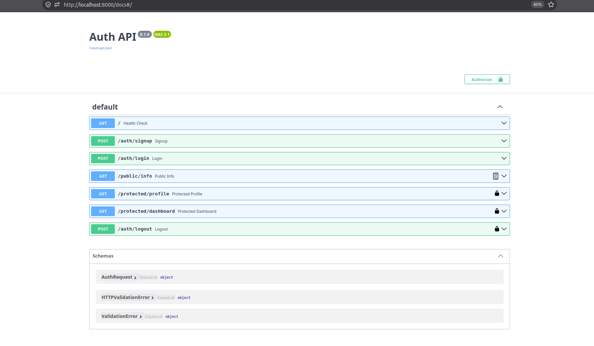

# Secure Auth API (FastAPI & Supabase)

This small project is a assignment 4 done for the flyrank ai backend engineering track.


### Key Features
* **Authentication:** Secure user registration and login handled via Supabase.
* **Authorization:** JWT extraction and validation using reusable FastAPI dependencies (middleware).
* **Environment Security:** Sensitive credentials isolated in a `.env` file and excluded from version control.
* **Interactive Documentation:** Automatic Swagger UI generation with built-in Bearer Token authorization.

---

## Local Setup & Installation

### 1. Clone the Repository
```bash
git clone https://github.com/Shayankhan123-dev/flyrank_assignment4
cd auth_assignment
```

### 2. Configure the Virtual Environment
```bash
python -m venv venv
source venv/bin/activate  # On Windows use: venv\Scripts\activate
pip install -r requirements.txt
```

### 3. Environment Variables
Create a `.env` file in the root directory. You will need a free [Supabase](https://supabase.com/) project to generate these keys.
```env
SUPABASE_URL=your_supabase_project_url
SUPABASE_KEY=your_supabase_publishable_anon_key
```
*Note: Ensure your `.env` file is listed in your `.gitignore` before committing.*

---

##  Running the Server

Start the FastAPI server using Uvicorn with a single terminal command:
```bash
uvicorn main:app --reload
```

* The API will be available at: `http://localhost:8000`
* The interactive documentation will be available at: `http://localhost:8000/docs`

---

##  API Route Reference

| Method | Endpoint | Purpose | Auth Required |
|--------|----------|---------|---------------|
| `POST` | `/auth/signup` | Create a new user account | No |
| `POST` | `/auth/login` | Authenticate user & return JWT | No |
| `POST` | `/auth/logout` | Terminate the user session | Yes (Bearer Token) |
| `GET`  | `/public/info` | Read public, unprotected data | No |
| `GET`  | `/protected/profile` | Read private user profile data | Yes (Bearer Token) |
| `GET`  | `/protected/dashboard` | Access the secure dashboard | Yes (Bearer Token) |

---

##  Swagger UI & Testing

FastAPI automatically generates an interactive Swagger UI. You can securely test the protected routes directly in the browser:
1. Navigate to `/docs`.
2. Generate a token via the `/auth/login` route.
3. Click the **Authorize** padlock button at the top right and paste your JWT.
4. Execute requests on the protected endpoints.

